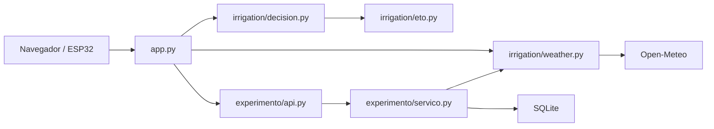

# Sistema de Irrigação Inteligente

Protótipo web que calcula a necessidade hídrica do rabanete (Penman-Monteith FAO-56), consulta a previsão de chuva e compara a decisão de irrigação de três grupos experimentais, com acompanhamento do experimento em banco de dados.


[](docs/p2/Artigo_TCC_Irrigacao_Inteligente.pdf)

## Sumário

- [Sobre o projeto](#sobre-o-projeto)
- [Funcionalidades](#funcionalidades)
- [Início rápido](#início-rápido)
- [Instalação](#instalação)
- [Uso](#uso)
- [Regras de decisão e definições](#regras-de-decisão-e-definições)
- [API](#api)
- [Exemplos incluídos](#exemplos-incluídos)
- [Arquitetura](#arquitetura)
- [Tratamento de erros](#tratamento-de-erros)
- [Testes](#testes)
- [Publicação no Render](#publicação-no-render)
- [Estrutura do projeto](#estrutura-do-projeto)
- [Limitações conhecidas](#limitações-conhecidas)
- [Solução de problemas](#solução-de-problemas)
- [Documentação](#documentação)
- [Autores](#autores)
- [Licença](#licença)

## Sobre o projeto

Trabalho de Conclusão de Curso de Engenharia de Computação da Fundação Hermínio Ometto (FHO), Araras (SP). O projeto propõe um sistema de irrigação que decide quando e quanto irrigar a partir da evapotranspiração da cultura, da umidade do solo e da previsão de chuva, e o compara com dois métodos tradicionais usados como grupos controle.

Este repositório contém a lógica de decisão (implementada em Python/Flask) e a infraestrutura de acompanhamento do experimento. O hardware (ESP32 e sensores) ainda não foi construído.

O projeto trata de:

1. **Desperdício de água na irrigação por tempo fixo.** O grupo Experimental calcula a demanda diária em vez de aplicar uma lâmina constante.
2. **Irrigação desnecessária antes de chuva.** O grupo Experimental suspende a irrigação quando a chance de chuva é alta.
3. **Falta de comparação objetiva entre estratégias.** Os três grupos são decididos com os mesmos dados do dia e registrados em banco para análise.

## Funcionalidades

- Cálculo da ETo diária pelo método Penman-Monteith (FAO-56) com dados da Open-Meteo.
- Cálculo da ETc (ETo × Kc) com os coeficientes do rabanete: inicial 0,70, médio 0,90, final 0,85.
- Conversão da lâmina (mm) em volume (L) e tempo de irrigação (min), conforme área e vazão.
- Decisão para os três grupos: Controle A (lâmina fixa), Controle B (limiar de umidade) e Experimental (ETc, clima e solo).
- Painel `/` com comparação lado a lado dos três grupos, tema claro e escuro e layout para celular.
- Apresentação interativa em `/apresentacao`.
- Acompanhamento do experimento em `/experimento`: volume, umidade, saúde da planta, acionamentos evitados, precisão da previsão e eficiência no uso da água (EUA).
- API de ingestão protegida por token, banco SQLite e exportação em CSV.

## Início rápido

Requer Python 3.11 ou superior.

```bash
git clone https://github.com/Scaglia05/irrigacao-inteligente.git
cd irrigacao-inteligente
pip install -r requirements.txt
python app.py
```

Acesse `http://localhost:5000`. O repositório é privado; o clone exige acesso à conta `Scaglia05`.

## Instalação

| Requisito | Versão | Finalidade |
|---|---|---|
| Python | 3.11 ou superior (testado com 3.11.9) | Execução do servidor |
| Flask | 3.0.3 | Servidor web |
| requests | 2.32.3 | Chamadas à Open-Meteo |
| gunicorn | 22.0.0 | Servidor em produção (Render) |
| Acesso à internet | — | Previsão do tempo e geocodificação |

Crie e ative um ambiente virtual:

```bash
python -m venv .venv
```

```bash
# Windows (PowerShell)
.venv\Scripts\Activate.ps1

# Linux ou macOS
source .venv/bin/activate
```

```bash
pip install -r requirements.txt
```

Variáveis de ambiente (todas opcionais):

| Variável | Padrão | Finalidade |
|---|---|---|
| `PORT` | `5000` | Porta do servidor ao executar `python app.py` |
| `INGEST_TOKEN` | não definida | Token exigido no cabeçalho `X-API-Key` das rotas que gravam. Sem ele, a escrita fica desativada |
| `DATABASE_PATH` | `data/experimento.db` | Arquivo SQLite do experimento (pasta `data/` ignorada pelo Git) |

## Uso

### Painel de decisão

Abra `http://localhost:5000`, escolha a cidade, o grupo, a fase da cultura, a área e a vazão, e use **Calcular irrigação** ou **Comparar os 3 grupos**. A umidade do solo é informada manualmente no painel.

### Acompanhamento do experimento

Abra `http://localhost:5000/experimento`. Para gravar dados, defina o token antes de iniciar o servidor e informe-o no campo da tela:

```powershell
$env:INGEST_TOKEN = "troque-por-um-segredo"
python app.py
```

Exemplo de envio de uma leitura de solo (o que o firmware do ESP32 fará):

```powershell
$h = @{ "X-API-Key" = $env:INGEST_TOKEN }
Invoke-RestMethod -Method Post -Uri http://localhost:5000/api/exp/leituras -Headers $h `
  -ContentType "application/json" -Body '{"grupo":"experimental","umidade_pct":41.5}'
```

Exemplo de comparação dos três grupos, executado em 15/11/2026 para Rio Claro (local do experimento):

```bash
curl -X POST http://localhost:5000/api/comparar -H "Content-Type: application/json" \
  -d '{"area_m2":0.25,"vazao_l_h":120,"umidade_solo":40}'
```

Resumo da resposta (campos selecionados):

| Grupo | `irrigar` | `codigo` | `volume_l` | `duracao_min` |
|---|---|---|---|---|
| `controle_a` | `true` | `programado` | 0,94 | 0,5 |
| `controle_b` | `false` | `solo_acima_limiar` | 0,0 | 0,0 |
| `experimental` | `false` | `chuva_prevista` | 0,0 | 0,0 |

Nesse dia a previsão era de 81% de chance de chuva, ETo de 4,096 mm e ETc de 3,686 mm. O resultado muda a cada dia com a previsão.

## Regras de decisão e definições

| Grupo | Regra |
|---|---|
| Controle A | Aplica uma lâmina fixa diária (padrão 3,75 mm), sem considerar clima ou solo |
| Controle B | Aplica a mesma lâmina fixa se a umidade do solo for menor que 35% |
| Experimental | Suspende se a chance de chuva for 60% ou mais, ou se o solo estiver com 50% ou mais; caso contrário, aplica a ETc do dia |

Definições adotadas:

- **Lâmina e volume:** 1 mm sobre 1 m² equivale a 1 L. Volume (L) = lâmina (mm) × área (m²).
- **Lâmina padrão de 3,75 mm:** ETc média do rabanete (Kc 0,90) em Rio Claro entre 01/02/2026 e 30/04/2026. Foi calculada por `analise/validacao_eto_e_linha_base.py`. Evita que a economia do grupo Experimental seja efeito de um controle superdimensionado.
- **Chance de chuva:** máximo da probabilidade horária das primeiras 24 horas retornadas pela Open-Meteo, a partir da meia-noite do dia corrente.
- **Decisão:** uma por grupo e por dia.
- **Volume nas métricas:** o volume aplicado, quando há acionamentos registrados; senão, o planejado pela decisão.
- **EUA:** massa fresca média por vaso ÷ (volume do grupo ÷ número de vasos), supondo doses iguais entre os vasos do grupo.
- **Previsão correta:** a chance de chuva igual ou superior a 60% coincide com chuva observada igual ou superior a 1 mm.

## API

Rotas do painel:

| Rota | Método | Função |
|---|---|---|
| `/` | GET | Painel de decisão |
| `/apresentacao` | GET | Apresentação interativa |
| `/experimento` | GET | Acompanhamento do experimento |
| `/api/localizacao?cidade=` | GET | Converte cidade em latitude, longitude e altitude |
| `/api/calcular` | POST | Decisão de um grupo (`grupo`, `latitude`, `longitude`, `elevation`, `area_m2`, `vazao_l_h`, `umidade_solo`, `fase_cultura`, `lamina_fixa_mm`) |
| `/api/comparar` | POST | Decisão dos três grupos, com os mesmos parâmetros |

Rotas do experimento (prefixo `/api/exp`; as de escrita exigem `X-API-Key`):

| Rota | Método | Quem usa | Função |
|---|---|---|---|
| `/metricas` | GET | Tela | Métricas e séries de todos os grupos |
| `/config` | GET, PUT | Tela | Lê ou altera os parâmetros do experimento (PUT exige token) |
| `/leituras` | POST | ESP32 | Grava a umidade do solo: `{"grupo": "experimental", "umidade_pct": 41.5}` |
| `/decidir` | POST | ESP32 ou tela | Consulta a previsão, decide e registra o dia: `{}` (todos os grupos) ou `{"grupo": "controle_b"}` |
| `/acionamentos` | POST | ESP32 | Registra a água realmente aplicada: `{"grupo": "experimental", "volume_l": 1.02}` |
| `/medicoes` | POST | Tela | Altura, folhas e massa fresca ou seca por vaso |
| `/chuva-observada/atualizar` | POST | Tela | Busca a chuva observada para os dias já encerrados |
| `/export/<tabela>.csv` | GET | Análise | Tabelas `decisoes`, `leituras`, `acionamentos`, `medicoes` e `clima` |

## Exemplos incluídos

| Arquivo | Descrição | Pré-requisitos |
|---|---|---|
| `analise/validacao_eto_e_linha_base.py` | Compara a ETo do app com a da Open-Meteo e calcula a economia do grupo Experimental para diferentes linhas de base do Controle A; grava um CSV diário opcional | Exige internet |
| `docs/p2/Artigo_TCC_Irrigacao_Inteligente.pdf` | Artigo da etapa pré-TCC (P2), versão final | Leitor de PDF |
| `docs/p2/Apresentacao_TCC_P2.pdf` | Slides da etapa P2 | Leitor de PDF |

Execução do primeiro exemplo (período de 01/02 a 30/04/2026, Rio Claro, Kc 0,90), com a saída resumida:

```bash
python analise/validacao_eto_e_linha_base.py 2026-02-01 2026-04-30
```

```
89 dias validos | Rio Claro-SP (-22.4114, -47.5614) | Kc = 0.9
app com vento MAXIMO diario   vies=+0.028  MAE=0.144  RMSE=0.182  r=0.985  (mm/dia)
ETc media: 3.75 mm/dia | dias com chuva >= 1 mm (proxy de previsao): 43 de 89
= ETc media (conservadora)    3.75 mm/dia   economia do Exp.: 41.6%
= ETc maxima do periodo       5.59 mm/dia   economia do Exp.: 60.8%
```

A economia depende da linha de base escolhida: quanto maior a lâmina do Controle A, maior a economia aparente do Experimental.

## Arquitetura



| Módulo | Responsabilidade |
|---|---|
| `app.py` | Rotas do painel e registro do blueprint do experimento |
| `irrigation/eto.py` | ETo pelo Penman-Monteith (FAO-56) e coeficientes Kc do rabanete |
| `irrigation/weather.py` | Geocodificação e previsão diária na Open-Meteo |
| `irrigation/decision.py` | Regras dos três grupos e conversão de lâmina em volume e tempo |
| `experimento/db.py` | Esquema SQLite e parâmetros padrão |
| `experimento/servico.py` | Validação, registro, métricas, EUA, previsão e CSV |
| `experimento/api.py` | Rotas `/api/exp`, autenticação por token e tratamento de erros |
| `analise/validacao_eto_e_linha_base.py` | Valida a ETo do app contra a da Open-Meteo e calcula a linha de base |

Decisões de projeto: a leitura da API é pública e a escrita só funciona com `INGEST_TOKEN` definido; o banco usa apenas a biblioteca padrão (`sqlite3`); os mesmos valores de decisão alimentam o painel e o registro do experimento.

## Tratamento de erros

| Origem | Código HTTP | Mensagem de exemplo |
|---|---|---|
| Escrita sem `INGEST_TOKEN` no servidor | 503 | `Escrita desativada: INGEST_TOKEN não está configurado no servidor` |
| Token incorreto ou ausente | 401 | `Token inválido ou ausente (cabeçalho X-API-Key)` |
| Campo obrigatório ausente | 400 | `Campo obrigatório: umidade_pct` |
| Grupo inválido (`/api/exp`) | 400 | `Grupo desconhecido: 'x'. Use: controle_a, controle_b, experimental` |
| Grupo inválido (`/api/calcular`) | 400 | `Grupo desconhecido: x` |
| Cidade inexistente | 400 | `Cidade não encontrada: zzzzqqqq` |
| Decisão sem leitura de solo (Controle B, Experimental) | resposta com campo `erros` | `Sem leitura de umidade do solo para controle_b: registre uma leitura antes de decidir` |
| Falha na Open-Meteo | 502 | `Falha ao consultar previsão do tempo: ...` |

## Testes

```bash
python -m unittest discover -s tests -v
```

Executados em ambiente virtual novo com Python 3.11.9: 27 testes, todos aprovados. Cobrem token, validação, decisão, métricas, EUA, previsão de chuva, exportação CSV e resposta das páginas. Não exigem internet: previsão e chuva são simuladas. As rotas `/api/calcular` e `/api/comparar` têm apenas um teste de regressão.

Análise opcional com dados reais (exige internet):

```bash
python analise/validacao_eto_e_linha_base.py 2026-02-01 2026-04-30
```

## Publicação no Render

O arquivo `render.yaml` descreve o serviço (plano gratuito, Python 3.11.9).

1. Suba o repositório para o GitHub.
2. No Render, selecione **New +** e **Web Service** e conecte o repositório.
3. Confirme os comandos detectados em `render.yaml`:
   - Build: `pip install -r requirements.txt`
   - Start: `gunicorn app:app --bind 0.0.0.0:$PORT`
4. Para usar as rotas de escrita, defina `INGEST_TOKEN` nas variáveis de ambiente do serviço.

Instância atual: `https://irrigacao-inteligente-hh7z.onrender.com/`. No plano gratuito o serviço dorme após alguns minutos sem uso e leva cerca de 30 segundos para responder à primeira requisição seguinte. O comando `gunicorn` não foi executado no ambiente Windows desta verificação; o deploy no Render é a referência.

## Estrutura do projeto

```
.
├── app.py                      # Servidor Flask e rotas do painel
├── irrigation/
│   ├── eto.py                  # ETo (Penman-Monteith FAO-56) e Kc
│   ├── weather.py              # Integração com a Open-Meteo
│   └── decision.py             # Regras dos três grupos
├── experimento/
│   ├── api.py                  # Rotas /api/exp
│   ├── servico.py              # Registro, métricas, EUA e CSV
│   └── db.py                   # Esquema SQLite
├── analise/
│   └── validacao_eto_e_linha_base.py
├── templates/                  # index, apresentacao, experimento
├── static/                     # css, js e imagens
├── tests/
│   └── test_experimento.py
├── docs/
│   ├── p1-beta/                # Projeto CEP e apresentação (versão beta da P1)
│   └── p2/                     # Texto e apresentação da P2
├── render.yaml
├── requirements.txt
└── README.md
```

## Limitações conhecidas

- O hardware (ESP32, sensores e válvulas) não foi construído; a umidade do solo é informada manualmente ou por requisição à API.
- A decisão usa o dia corrente do calendário e o máximo da probabilidade horária; a interface descreve esse valor como "próximas 24 h".
- A EUA supõe doses iguais entre os vasos de um grupo.
- No plano gratuito do Render o disco é efêmero: o banco SQLite é apagado a cada reinício.
- `/api/calcular` e `/api/comparar` não validam números: um valor não numérico (por exemplo, `"area_m2": "abc"`) retorna erro 500.
- Não há autenticação para leitura; qualquer pessoa com o endereço acessa as métricas.
- O backend final do TCC está previsto em C#/.NET; este protótipo usa a mesma matemática em Python.
- Não há integração contínua configurada.
- Os resultados do experimento ainda não existem; os dados exibidos em testes são fictícios.

## Solução de problemas

| Sintoma | Causa provável | Ação |
|---|---|---|
| `python3` abre a Microsoft Store (Windows) | Atalho do sistema no lugar do Python | Use `python` |
| `Activate.ps1` bloqueado | Política de execução do PowerShell | Execute `Set-ExecutionPolicy -Scope Process Bypass` e ative novamente |
| `Falha ao consultar previsão do tempo` (502) | Sem internet ou Open-Meteo indisponível | Verifique a conexão e tente novamente |
| `Escrita desativada` (503) | `INGEST_TOKEN` não definido | Defina a variável e reinicie o servidor |
| `Token inválido ou ausente` (401) | Cabeçalho `X-API-Key` diferente do token do servidor | Use o mesmo valor em ambos |
| Porta 5000 em uso | Outro processo na porta | Defina `PORT` com outro número |
| Dados do experimento sumiram no Render | Disco efêmero do plano gratuito | Exporte os CSV com frequência ou use disco persistente |

## Documentação

Artigo da etapa pré-TCC (P2), com 19 páginas: introdução, referencial teórico, trabalhos correlatos, material e método, resultados esperados e conclusão. Também estão em `docs/p2/` os slides (`Apresentacao_TCC_P2.pdf`) e, em `docs/p1-beta/`, o projeto da etapa anterior.

[](docs/p2/Artigo_TCC_Irrigacao_Inteligente.pdf)

Referências do cálculo:

- ALLEN, R. G.; PEREIRA, L. S.; RAES, D.; SMITH, M. *Crop evapotranspiration: guidelines for computing crop water requirements.* FAO Irrigation and Drainage Paper 56. Rome: FAO, 1998.
- ZOTARELLI, L. et al. *Step by step calculation of the Penman-Monteith evapotranspiration (FAO-56 method).* AE459. University of Florida, IFAS Extension, 2010.
- Dados climáticos: [Open-Meteo](https://open-meteo.com).

## Autores

- Guilherme Augusto Scaglia (autor)
- Prof. Pedro Luís Antonelli (orientador)

Engenharia de Computação, Fundação Hermínio Ometto (FHO), Araras (SP).

## Licença

Nenhuma licença foi definida até o momento.
